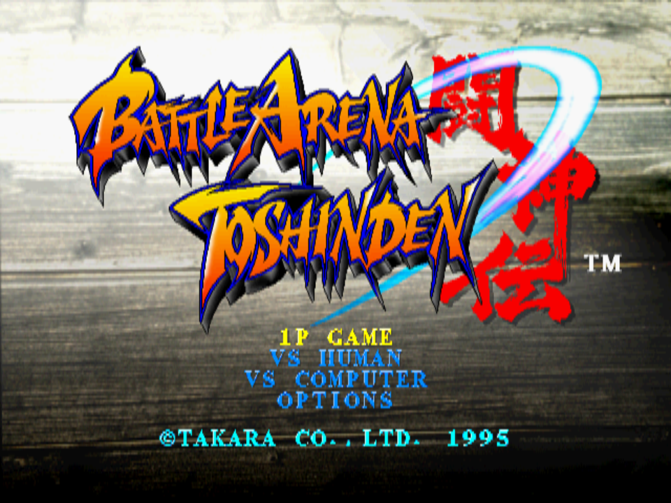
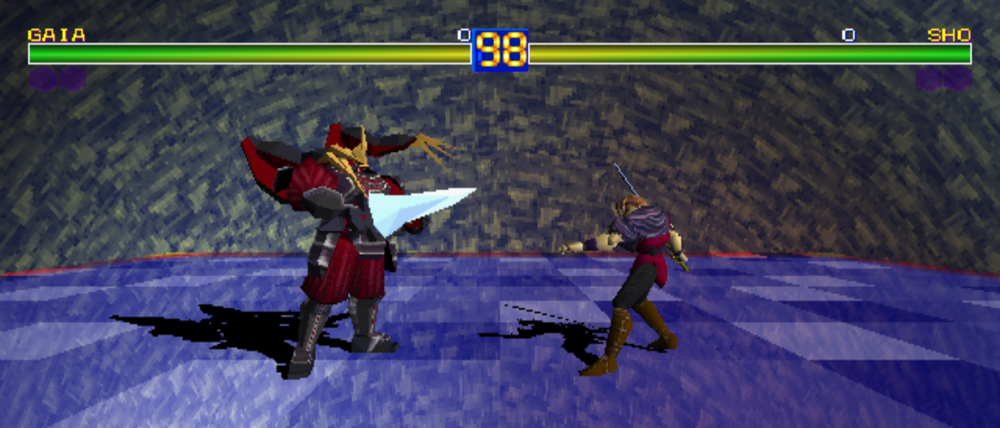
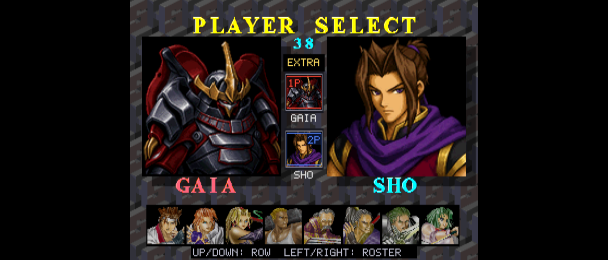

# Battle Arena Toshinden Recompiled

Static recompilation of **Battle Arena Toshinden (USA)**, PlayStation serial
**SCUS-94200**, to native code using [psxrecomp](https://github.com/mstan/psxrecomp)
and [recomp-ui](https://github.com/mstan/recomp-ui).

<p align="center">
  
</p>

*The original title screen, presented at its native 4:3 aspect ratio.*

## Status

**0.1.4** adopts the shared optimized release pipeline and current launcher.
The game remains an early release.
Bug reports are welcome; see
[validation notes](validation/README.md) for the tested build and scope.

The game boots through its introduction and character selection into combat.
The launcher includes disc setup, settings, and a Mods page.

## Enhancements

**Battle Arena Toshinden Widescreen** offers fixed 16:9 and Adaptive. Adaptive
follows the current window or fullscreen aspect from 4:3 through 32:9, the
framework's current limit. Wider gameplay views reveal more of the stage;
health gauges extend to the perimeter while labels, icons, timer, and pause UI
retain their authored proportions. True 2D screens retain their 4:3 presentation.



*21:9 gameplay with adaptive widescreen enabled. The stage view expands while
characters, text, and icons retain their proportions.*

**Battle Arena Toshinden Frame Blending** presents completed game frames at
the display's measured refresh rate or a selected 60, 90, 120, 144, 165, or
240 Hz target. Motion-adaptive blending reduces trails on large image changes.
Game simulation, inputs, timers, and audio retain their original cadence.
This is temporal image blending, not motion-vector frame generation.

**Battle Arena Toshinden Extra Roster** adds Gaia and Sho as optional selectable
fighters. The normal eight-character roster stays in place as the bottom row;
Sho is the middle extra row and Gaia is the top extra row. Up cycles roster to
Sho to Gaia to roster, Down cycles roster to Gaia to Sho to roster, and
Left/Right only moves through the regular roster. The normal confirm button
starts the match through the game's selection path. Press Select for an alternate
costume and matching portrait, including new poses for Gaia and Sho. Each player
can choose independently. The package uses new generated portrait art; source details are documented in
[portrait sources and generation prompts](assets/mods/boss-roster/SOURCE.md).



*Gaia and Sho in the extra selection rows, with original-game-inspired mod portraits.
Up/Down moves between rows; Left/Right moves within the regular roster only.*

**Battle Arena Toshinden Desperation at Any Health** lets players perform
each character's normal desperation command at any health. It does not add a
one-button shortcut and does not change health, damage, KO handling, max HP, or
HUD gauges.

The shared framework also supplies standard enhancement packages, including
PGXP. Each package's description and options are available on the Mods page.
All title enhancements are optional and disabled by default.

Fresh profiles enable the shared **Internal Resolution** mod at **4x**, with
**1x through 32x** choices subject to GPU texture and memory limits. Existing
mod selections are preserved; disabling this mod selects native resolution.
CD Speed and Fast Loading packages are excluded from public releases.

## Playing

Download the current **Windows ZIP** from
[Releases](https://github.com/mstan/BattleArenaToshindenRecomp/releases/latest).
Extract the package before running it; it contains the compiled game runtime.
The earlier [v0.1.3 Linux AppImage](https://github.com/mstan/BattleArenaToshindenRecomp/releases/tag/v0.1.3)
remains available separately and requires glibc 2.38 or newer. The current
source retains its Linux AppImage build route; this Windows release does not
claim a newly built or qualified Linux artifact.

Select your legally obtained **USA BIN/CUE disc image** in the launcher, use
Generate & Build when prompted, and launch the game. Keep all 14 tracks beside
the CUE file so the game can play its CD audio.

The public build supplies MIT-licensed OpenBIOS and an OpenBIOS-only backend.
Older validation using SCPH1001 remains historical evidence. Disc images and
retail BIOS files are not included in this repository or public package.

Enable enhancements on the launcher's **Mods** page. The title's widescreen,
frame blending, and optional gameplay packages are disabled by default. Saves and
mod selections are local to the installation.

Controllers use digital D-pad mode automatically. Select your connected
controller in the launcher; press **Select** on the character screen to choose
an alternate costume.

## Layout

- `iso/` - local disc image and audio tracks, ignored by Git.
- `disc/` - extracted `SCUS_942.00` boot executable and disc files, ignored by Git.
- `seeds/` - function entry points used by the recompiler.
- `generated/` - generated native C, rebuilt locally and ignored by Git.
- `src/mods/` - title-specific native mod plugins.
- `mods/preloaded/` - bundled mod manifests and documentation.
- `psxrecomp/` and `recomp-ui/` - pinned framework and launcher submodules.
- `game.toml` - disc identity, compilation, and runtime configuration.

## Build

Initialize the pinned submodules, then use the framework's setup commands
from this directory with Python 3 and the supported RetComM toolchain:

```sh
git submodule update --init --recursive
python psxrecomp/psxrecomp_cli.py generate --config game.toml --project-root . --disc "iso/Battle Arena Toshinden (USA).cue"
python psxrecomp/psxrecomp_cli.py rebuild --config game.toml --project-root . --build-dir build-release --no-pgo
```

The Windows executable is `build-release/BattleArenaToshinden_Recompiled.exe`.
The launcher also exposes the same Generate & Build workflow. See the
[framework setup guide](psxrecomp/docs/GAME_PROJECT_SETUP.md) for prerequisites
and other platforms. SDL3 is the default host backend; SDL2 is an explicit
compatibility build option.

Official optimized game releases use the shared builder from the title root:

```powershell
& psxrecomp/tools/package_title_release.ps1 --channel public --platform windows --jobs 2
```

The original boot executable must be present at `disc/SCUS_942.00`, and the
original fourteen-track CUE/BIN set must match `game.toml`. The builder
regenerates source, performs fresh selective PGO on supported GNU/Ninja builds,
requires normal profiling close, and verifies the final public archive.
Profiling does not establish gameplay coverage or a per-title speedup.

`tools/package_release.ps1` and `tools/package_appimage.sh` delegate to this
builder and take its options. Linux builds additionally require the supported
Linux dependencies described in the shared releasing guide. The explicitly
dispatched setup-host CI workflow remains a no-disc host build; it does not
qualify a compiled optimized game release. See
[RELEASE_NOTES.md](RELEASE_NOTES.md) for current scope.

## Netplay

**Two-player rollback netplay is enabled**, using the shared recomp-net lobby
and transport. Open **NETPLAY** in the launcher to host or join an online room,
or use LAN / Direct IP. Each player configures their local controller under
**PLAYER 1 / NETPLAY**. Choose **VS HUMAN** in the game, or have P2 press Start
to join. Two standard digital controller ports are used; Multitap is disabled.

Both players need the same game build and the verified USA 14-track disc image.
Online rooms support the bundled **Extra Roster** mod: the host selects it with
the room's **Mods** button, and the guest can inspect the required selection with
**View Mods**. Both players can choose Gaia and Sho. The host's mod plan applies
to the session automatically; the guest's saved offline selection is preserved.
Required package versions and the resolved mod plan must match before launch.
Automatic mod downloads and resource-backed mods are not supported in this build.
LAN / Direct IP sessions retain the vanilla mod policy.

Validation covered a password-protected online room through the public relay,
host-to-guest mod selection, and Gaia versus Sho combat. This is a functional
online check, not exhaustive testing of different networks or adverse connection
conditions. See the [netplay guide](psxrecomp/docs/NETPLAY.md) for connection
options and the [validation notes](validation/README.md) for the tested scope
and known limits.
Those observations used earlier pinned builds. The 0.1.4 package/profile
checks do not repeat or broaden that netplay qualification.

## License

PolyForm Noncommercial 1.0.0. See `LICENSE`.

No game disc data or retail PlayStation BIOS is redistributed here. OpenBIOS
is provided under its MIT license; see the framework's OpenBIOS license notice.
Launcher box art attribution is recorded in
[BOXART_SOURCE.txt](launcher_assets/img/BOXART_SOURCE.txt).

<!-- retcomm-readme-raid -->
---

<p align="center">
  <sub><b>R.A.I.D. - Retro AI Development</b> / a Discord for AI-assisted retro reverse-engineering, decomp &amp; recomp</sub>
</p>

<p align="center">
  <a href="https://discord.gg/Ad9BwSzctP"></a>
</p>
<!-- /retcomm-readme-raid -->
